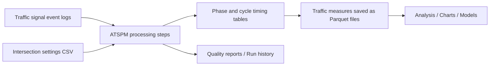
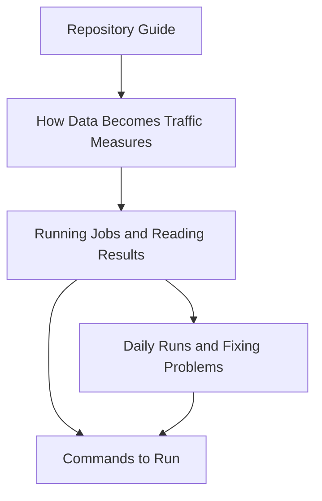
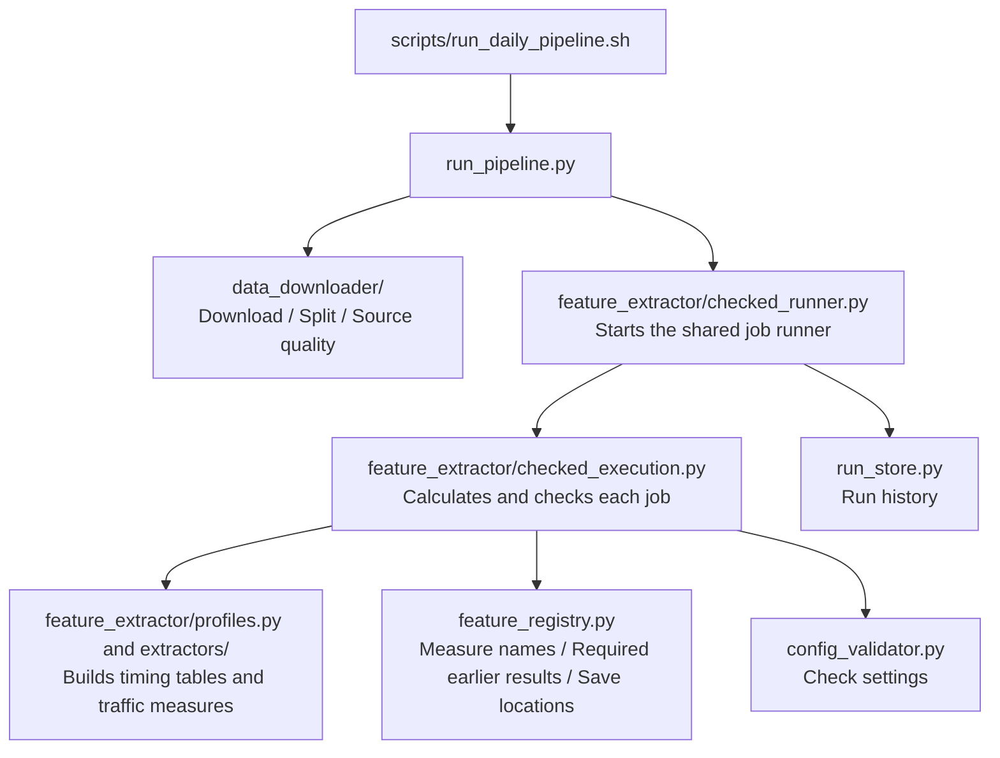

# ATSPM Repository Guide

This project reads traffic signal event logs and intersection settings, then calculates traffic measures for each signal cycle. One job processes **one signal on one source-file date**.



## Words Used in This Guide

| Term in the code | Plain meaning                                                               |
| ---------------- | --------------------------------------------------------------------------- |
| Signal           | One traffic signal controller, usually at an intersection                   |
| Event            | A recorded change, such as a light turning green or a detector switching on |
| Phase            | A traffic movement controlled by the signal, such as a left turn            |
| Cycle            | One full round of the signal sequence                                       |
| Profile          | A table of phase or cycle timings built from events                         |
| Feature          | A calculated measure, such as vehicle count or green time                   |
| Job / attempt    | One signal and date to process / one try at processing it                   |
| Dependency       | An earlier result needed by another calculation                             |
| Manifest         | A file listing the exact ㅍjobs to run and the input checks for each job    |
| Hash / signature | A file fingerprint used to check whether a file has changed                 |
| PKL / Parquet    | File formats used here to save result tables / input tables                 |

## Where to Start



| Document                                                  | Contents                                                             |
| --------------------------------------------------------- | -------------------------------------------------------------------- |
| [Data Flow](session_01_data_flow.md)                       | Input files, settings, timing tables, calculation order, saved files |
| [Run Jobs and Read Results](session_02_run_and_read.md)    | Choose jobs, check inputs, save results, read the latest run         |
| [Daily Runs and Fixing Problems](session_03_operations.md) | Daily runs, find problems, rerun affected jobs                       |
| [Commands to Run](lab_guide.md)                            | Run one job, read reports, rerun jobs                                |

## Main Code Files



| Path                                                                     | Role                                                             |
| ------------------------------------------------------------------------ | ---------------------------------------------------------------- |
| [run_pipeline.py](../../run_pipeline.py)                                  | Download → Check data → Split by signal → Calculate measures  |
| [feature_extractor/](../../feature_extractor/)                            | Check inputs, run jobs, save results and run history             |
| [profiles.py](../../feature_extractor/profiles.py) · [extractors/](../../feature_extractor/extractors/) | Code that builds timing tables and calculates traffic measures   |
| [dashboard/](../../dashboard/)                                            | Screen for starting jobs and checking progress                   |
| [scripts/](../../scripts/)                                                | Daily runs, checks, fixes, training data, model training         |
| [plot/](../../plot/)                                                      | Charts for analysis                                              |
| [tests/](../../tests/)                                                    | Tests for processing steps and calculations                      |
| [Processing Rules](../checked_pipeline.md)                                | Rules for checking input data and deciding whether a job is done |

## Code and Data Locations

```text
ATSPM/                          /data2/ATSPM/
├── run_pipeline.py             ├── raw_data/
├── data_downloader/            │   └── per_signal/
├── feature_extractor/          ├── config_data/
├── feature_extractor/              │   └── pipeline_runs.sqlite3
├── dashboard/                  └── operations/
├── scripts/                        ├── logs/
├── tests/                          ├── quality_cache/
└── docs/handover/                   └── runs/
```

Data is saved under `/data2/ATSPM` by default. Command options can change this location. Use a Markdown viewer that supports Mermaid to see the diagrams.

## Saved Examples

| File                                                   | Purpose                                        |
| ------------------------------------------------------ | ---------------------------------------------- |
| [cases.json](examples/cases.json)                       | Examples of past job results                   |
| [feature_previews.json](examples/feature_previews.json) | A few rows and columns from past result tables |

These old examples assumed the input data was usable. To check today's data or runs, read the current reports.
