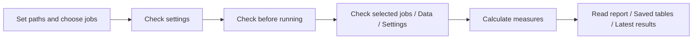
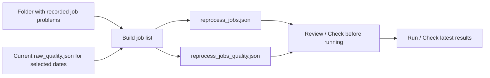

# Commands to Run

[Repository Guide](README.md) · [Run Jobs and Read Results](session_02_run_and_read.md) · [Daily Runs and Fixing Problems](session_03_operations.md)

## Steps to Follow



Run these commands in Bash from the project's top folder. Choose a signal and date with input files available. Keep using the same terminal so the variables below stay set.

## Set Paths, Signal, and Date

```bash
export ATSPM_PY=/home/ya195253/anaconda3/envs/atspm/bin/python
export ATSPM_SIGNAL=ORC-0003
export ATSPM_DATE=2026-09-06
export ATSPM_RAW=/data2/ATSPM/raw_data
export ATSPM_CONFIG=/data2/ATSPM/config_data/signal_config_2025/lanes
mkdir -p scratch
export ATSPM_WORK="$(mktemp -d "$PWD/scratch/handover.XXXXXX")"
export ATSPM_OUTPUT="$ATSPM_WORK/processed_data"
mkdir -p "$ATSPM_OUTPUT" "$ATSPM_WORK/reports"
"$ATSPM_PY" run_pipeline.py --help
```

```text
scratch/handover.XXXXXX/
├── .pipeline.lock
├── operations/
│   ├── quality_cache/
│   └── runs/<pipeline-run-id>/
├── processed_data/
│   ├── pipeline_runs.sqlite3
│   └── fdot_d5/feature_extraction/
└── reports/
```

## Check settings

```bash
"$ATSPM_PY" scripts/audit_signal_configs.py \
  --config-dir "$ATSPM_CONFIG" \
  --signals "$ATSPM_SIGNAL" \
  --data-date "$ATSPM_DATE" \
  --output-dir "$ATSPM_WORK/reports/config_audit"
```

Open `validation.json` or `validation.csv` to see whether the settings passed and why.

## Check Inputs, Then Run

```bash
ATSPM_ARGS=(
  --steps extract
  --start-date "$ATSPM_DATE" --end-date "$ATSPM_DATE"
  --signals "$ATSPM_SIGNAL"
  --features spat volume occupancy
  --raw-dir "$ATSPM_RAW"
  --per-signal-dir "$ATSPM_RAW/per_signal"
  --config-dir "$ATSPM_CONFIG"
  --processed-dir "$ATSPM_OUTPUT"
  --max-workers 1
)

"$ATSPM_PY" run_pipeline.py "${ATSPM_ARGS[@]}" \
  --dry-run --summary-file "$ATSPM_WORK/reports/preflight.json"

"$ATSPM_PY" -m json.tool "$ATSPM_WORK/reports/preflight.json"
```

Check `jobs` for the selected signals and dates, `features` for all planned calculations, `validation` for settings checks, and `source_quality` for input checks. Zero jobs means nothing was selected. A dry run still writes quality reports, saved check results, and a lock file.

After fixing input and settings problems, run the same jobs.

```bash
"$ATSPM_PY" run_pipeline.py "${ATSPM_ARGS[@]}" \
  --summary-file "$ATSPM_WORK/reports/feature_summary.json"
ATSPM_RC=$?
printf 'Extraction exit code: %s\n' "$ATSPM_RC"
```

## Read the Report and Saved Tables

```bash
"$ATSPM_PY" - <<'PYCODE'
import json
import os
from pathlib import Path
import pandas as pd
from feature_extractor.storage import read_frame

path = Path(os.environ['ATSPM_WORK']) / 'reports/feature_summary.json'
report = json.loads(path.read_text())
print('Run:', report['status'], 'Source:', report.get('source_status'))
for outcome in report['outcomes']:
    print(outcome['signal_id'], outcome['date_str'], outcome['status'])
    for name, result in outcome['results'].items():
        print(name, result['status'], result['reason_code'], result['row_count'])
        if name in ('spat', 'volume', 'occupancy') and result['status'] == 'success':
            frame = read_frame(result['output_file_path'])
            print(result['output_file_path'], frame.shape)
            print(frame.head(3).to_string(index=False))
PYCODE
```

If the program stops before writing its summary, read the terminal output and any reports it already saved.

## Read the Most Recent Result for a Job

```bash
"$ATSPM_PY" - <<'PYCODE'
import os
import sqlite3
from pathlib import Path

path = Path(os.environ['ATSPM_OUTPUT']) / 'pipeline_runs.sqlite3'
with sqlite3.connect(path.resolve().as_uri() + '?mode=ro', uri=True) as conn:
    conn.row_factory = sqlite3.Row
    rows = conn.execute("""
        SELECT a.attempt_id, a.run_id, a.signal_id, a.date_str,
               a.status AS job_status, f.name, f.status AS feature_status,
               f.reason_code, f.row_count, f.output_file_path
        FROM latest_attempts a
        JOIN feature_results f ON f.attempt_id = a.attempt_id
        WHERE a.signal_id = ? AND a.date_str = ?
        ORDER BY f.name
    """, (os.environ['ATSPM_SIGNAL'], os.environ['ATSPM_DATE'])).fetchall()
    print('Matching feature rows:', len(rows))
    for row in rows:
        print(dict(row))
PYCODE
```

Zero rows means the run history has no matching job attempt.

## Make a List of Jobs to Rerun



Set these two paths to existing job-check records and a current input-quality report. The commands above do not create the job-check records needed here.

```bash
export ATSPM_AUDIT_DIR=/path/to/actual/audit
export ATSPM_QUALITY_REPORT=/path/to/current/raw_quality.json

"$ATSPM_PY" scripts/build_reprocess_manifest.py \
  --audit-dir "$ATSPM_AUDIT_DIR" \
  --event-dir "$ATSPM_RAW/per_signal" \
  --config-dir "$ATSPM_CONFIG" \
  --quality-report "$ATSPM_QUALITY_REPORT" \
  --output "$ATSPM_WORK/reports/reprocess_jobs.json"

"$ATSPM_PY" -m json.tool "$ATSPM_WORK/reports/reprocess_jobs.json"

ATSPM_RECOVERY_ARGS=(
  --steps extract
  --jobs-file "$ATSPM_WORK/reports/reprocess_jobs.json"
  --quality-report "$ATSPM_WORK/reports/reprocess_jobs_quality.json"
  --raw-dir "$ATSPM_RAW"
  --per-signal-dir "$ATSPM_RAW/per_signal"
  --config-dir "$ATSPM_CONFIG"
  --processed-dir "$ATSPM_OUTPUT"
  --max-workers 1
)

"$ATSPM_PY" run_pipeline.py "${ATSPM_RECOVERY_ARGS[@]}" \
  --dry-run --summary-file "$ATSPM_WORK/reports/reprocess_preflight.json"
```

Before running, check `jobs` for the selected work, `blocked_candidates` for blocked jobs, and `deferred_missing_configs` for jobs without settings. Also check file fingerprints, reasons for selecting each job, and the dry-run report.

```bash
"$ATSPM_PY" run_pipeline.py "${ATSPM_RECOVERY_ARGS[@]}" \
  --summary-file "$ATSPM_WORK/reports/reprocess_execution.json"
```

If inputs or settings change, rebuild the job list. After the rerun, check its report and the latest result for each job.
