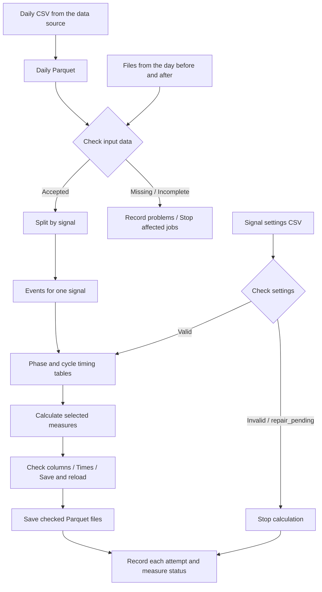
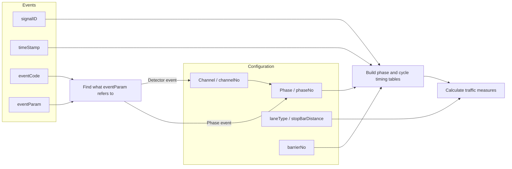
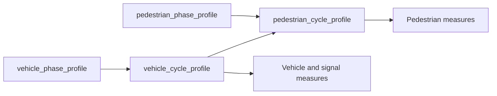
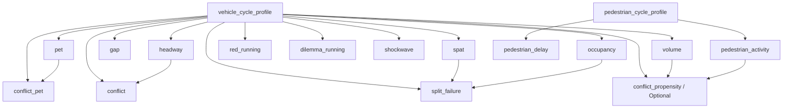
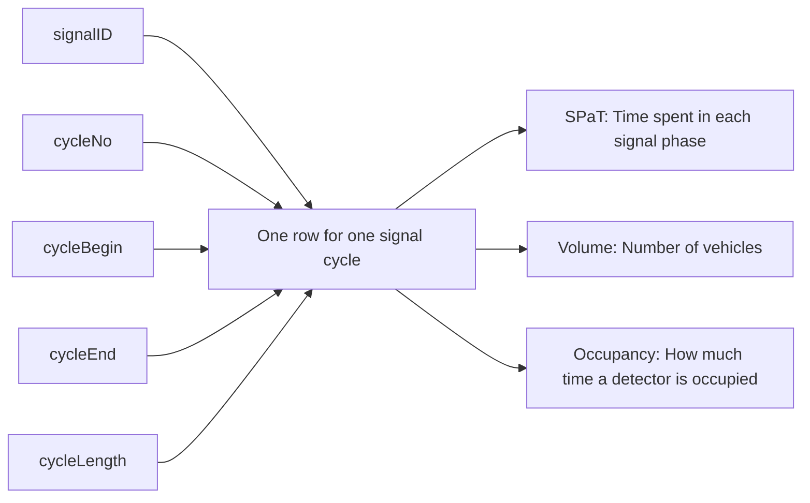

# How Data Becomes Traffic Measures

[Repository Guide](README.md) · [Run Jobs and Read Results](session_02_run_and_read.md)

## From Input Files to Saved Results



## Match Events with Signal Settings



Read `eventCode` to know what `eventParam` means. If the file date and event date differ, that alone does not tell you the timezone or when the source's day starts.

## Which Timing Tables Are Built First?



## What Each Measure Needs

An arrow means “this result is needed by the next calculation.” [feature_registry.py](../../feature_extractor/feature_registry.py) lists the exact names, required earlier results, and save locations.



| Selection                            | What Actually Runs                                             |
| ------------------------------------ | -------------------------------------------------------------- |
| Default                              | 4 timing tables + 14 traffic measures = 18 required results    |
| `--features spat volume occupancy` | Vehicle phase and cycle tables + selected measures = 5 results |
| `--features conflict_propensity`   | Optional measure and every earlier result it needs             |
| `conflict_headway`                 | Another name for`conflict`                                   |

## File Paths

```text
/data2/ATSPM/
├── raw_data/
│   ├── atspm-2026-9-6.parquet
│   └── per_signal/ORC-0003/atspm-2026-9-6.parquet
├── config_data/signal_config_2025/lanes/
│   └── ORC-0003.csv
└── processed_data/
    ├── pipeline_runs.sqlite3
    └── fdot_d5/feature_extraction/
        ├── signal_profile/
        │   ├── phase/{vehicle_signal,pedestrian_signal}/
        │   └── cycle/{vehicle_signal,pedestrian_signal}/
        └── feature/cycle/
            ├── vehicle_signal/spat/
            ├── vehicle_traffic/{volume,occupancy,...}/
            └── pedestrian_traffic/{activity,delay,conflict_propensity}/

Under each output directory: <signal_id>/<YYYY-MM-DD>.parquet
```

## How to Read a Result Row



Open the saved table to see all measure columns. Some cells may hold lists or other grouped values. A short preview only shows part of the table.
