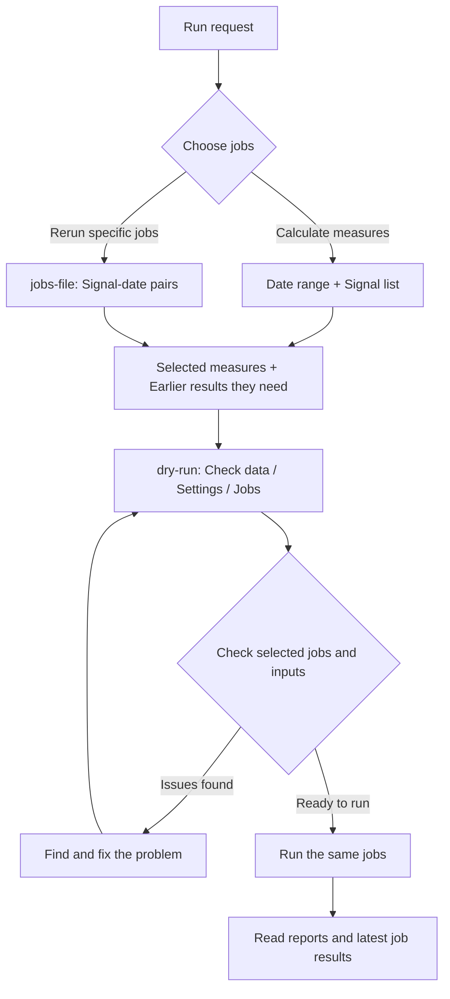
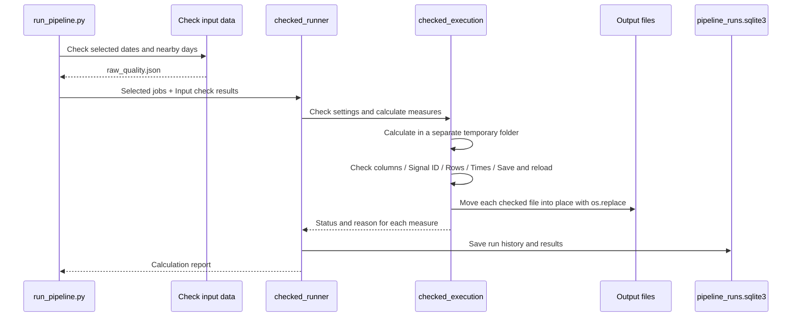
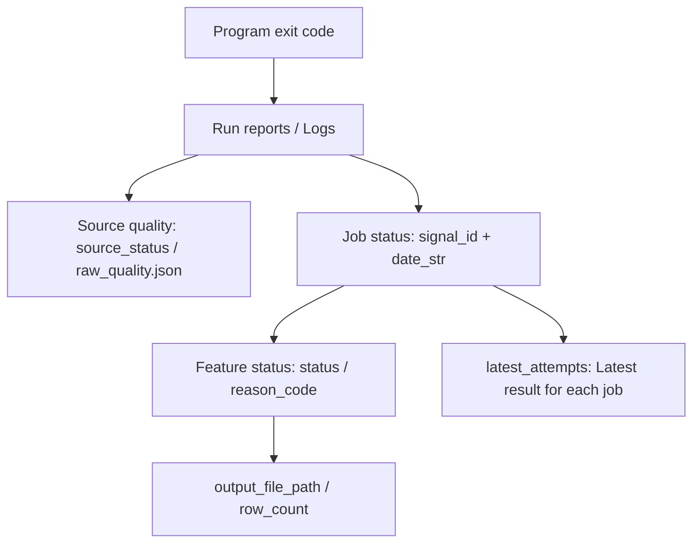
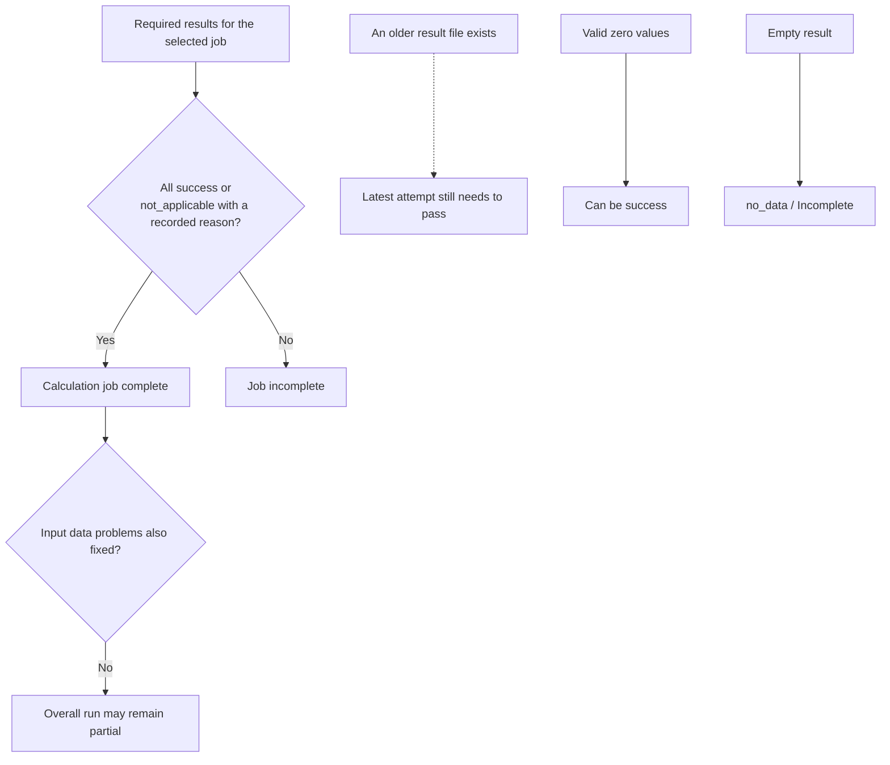
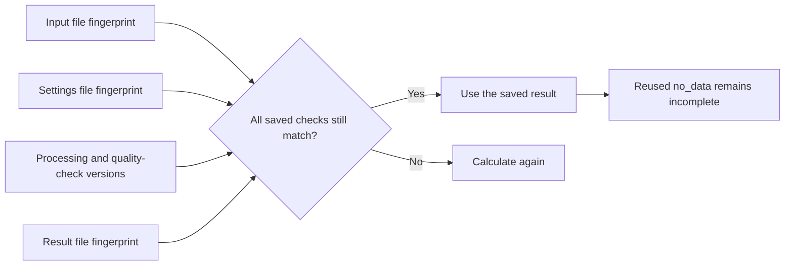

# Running Jobs and Reading Results

[Repository Guide](README.md) · [Commands to Run](lab_guide.md) · [Daily Runs and Fixing Problems](session_03_operations.md)

## Choose What to Run



| Option | Meaning |
|---|---|
| `--steps all` | Download, check data, split by signal, calculate measures |
| `--steps extract` | Calculate from existing signal files; also check original input data |
| `--start-date` / `--end-date` | Source date range |
| `--signals` | Choose signals to process |
| `--features` | Choose measures; earlier results they need are added automatically |
| `--jobs-file` | List of exact signals and dates, with input checks |
| `--processed-dir` | Folder for results and run history |
| `--summary-file` | Calculation report in JSON format |
| `--dry-run` | Check jobs and settings without calculating measures; still saves reports, check results, and a lock file |

Even if you choose one signal, input checks may read full daily files and files from the day before and after.

## Calculate, Check, and Save



## Read the Run, Job, and Measure Status



| Measure Status | Meaning |
|---|---|
| `success` | Result has usable rows, passed checks, and was saved; valid zero values are allowed |
| `no_data` | Input or result is empty, or required measure values are missing |
| `not_applicable` | A recorded reason confirms that this measure does not apply |
| `blocked` | Cannot run because input data, settings, or an earlier result has a problem |
| `failed` | Calculation, result checks, or saving failed |
| `skipped` | Left out for a recorded reason that applies to this date |



| Exit Code | What to Check |
|---|---|
| `0` | Read the report: work finished or no work was selected |
| `2` | `partial`: Check problems with input data and measures |
| `1` | Program failed; read logs if no report was saved |
| `75` | Another run is using the shared lock |

## Where to Find Reports and Results

```text
<processed-dir>/
├── pipeline_runs.sqlite3
└── fdot_d5/feature_extraction/.../<signal>/<date>.parquet

<parent-of-processed-dir>/operations/
├── quality_cache/
└── runs/<pipeline-run-id>/
    ├── raw_quality.json
    └── pipeline_summary.json

Path specified by --summary-file
└── Extraction summary JSON
```

## When Can an Earlier Result Be Used Again?



The old `processing_log.db` is kept. `imported_unverified` means an old file was recorded but has not passed the current checks.
