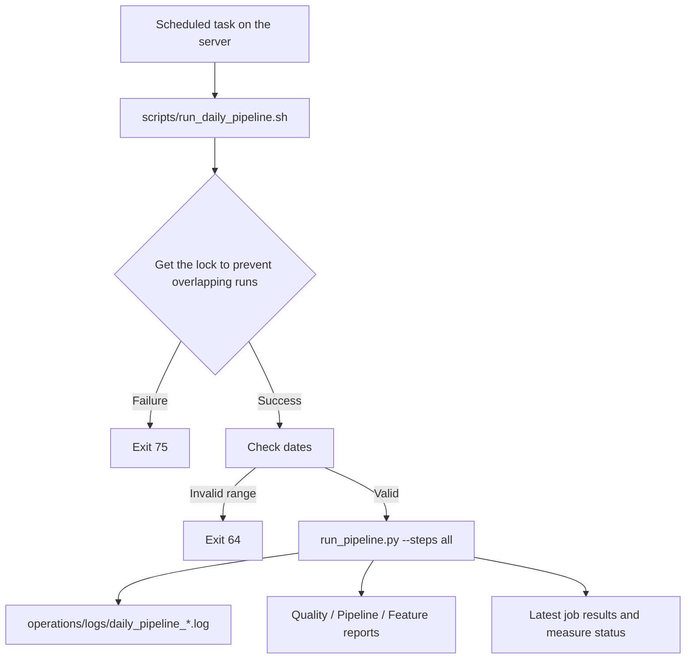
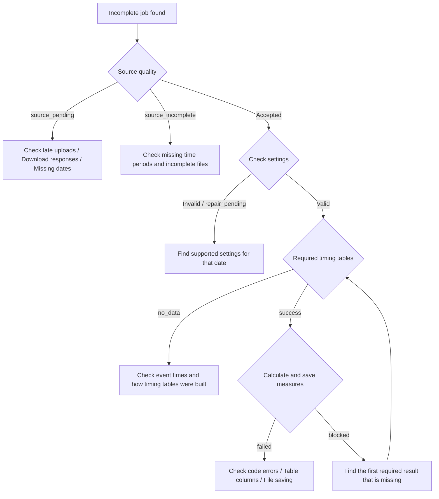
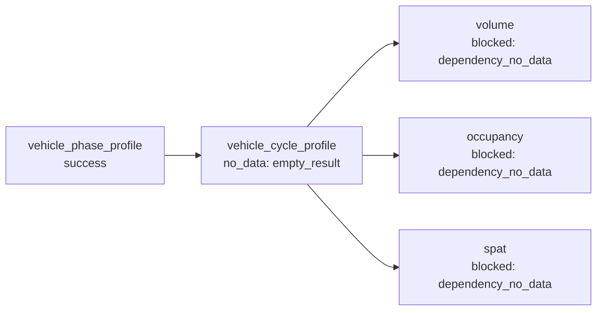
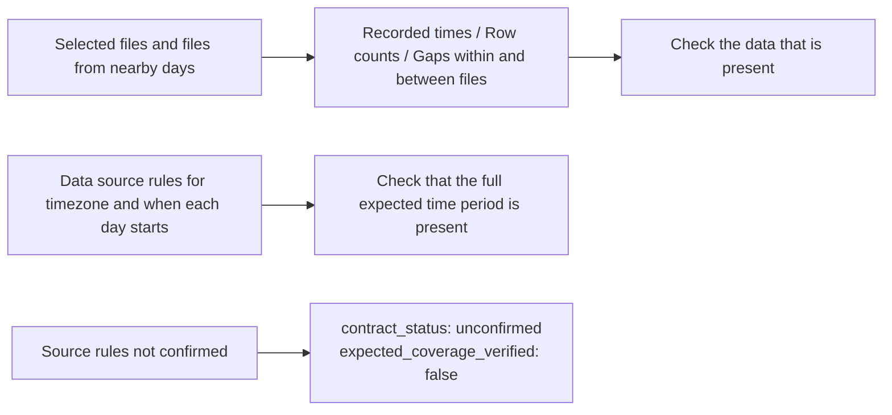
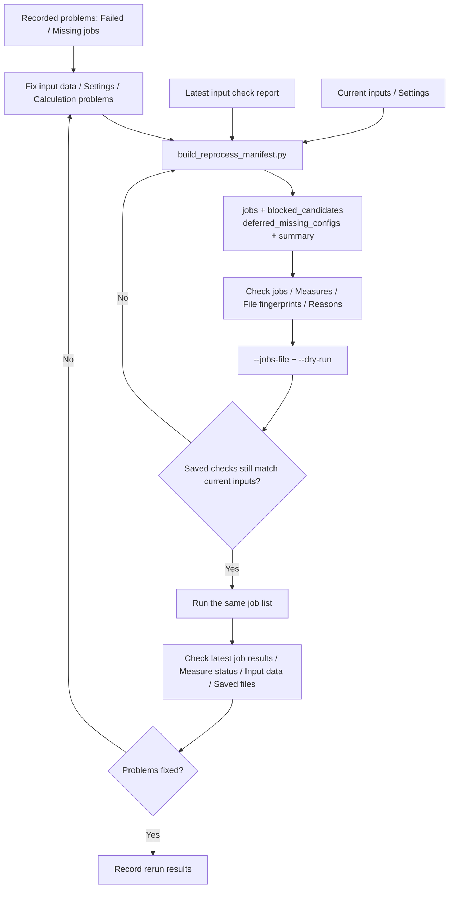
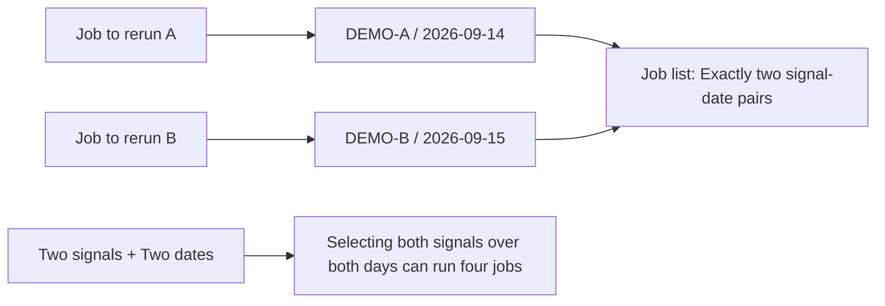

# Daily Runs and Fixing Problems

[Repository Guide](README.md) · [Run Jobs and Read Results](session_02_run_and_read.md) · [Commands to Run](lab_guide.md)

## Automatic Daily Runs



| Daily Script Default | Value |
|---|---|
| Date range | Last 14 days, through yesterday |
| Extraction workers | 24 |
| Split workers | 4 |
| Maximum date range | 60 days |
| Path | `/data2/ATSPM` |

Check the schedule and settings on the server. Having this script in the project does not mean it is scheduled to run.

## Find Where the Problem Starts



## How One Missing Result Stops Other Calculations



Start with the empty vehicle cycle table. Volume, occupancy, and SPaT need that table, so rerunning only those measures will not fix the problem.

## What Input Checks Can Tell You



No gaps in the data you have does not prove that you have the whole expected day.

## Rerun Only the Affected Jobs





Rebuild the job list when inputs or settings change. Do not edit file fingerprints to force old checks to pass. The list may have no jobs ready to run if input or settings problems remain.

## Daily Checks and Notes

| Check | Evidence |
|---|---|
| Did the run start, and which jobs did it select? | Server schedule, latest log, dates, number of parallel workers |
| Source status | `raw_quality.json`, missing dates, quality reasons |
| Incomplete jobs | Measure report, `latest_attempts` |
| Where the problem starts | Settings → Timing tables → Required earlier results → Calculation and saving |
| Jobs to rerun | Exact signals and dates, measures, current check results |
| Did the rerun work? | Latest job result, required measures, checked files |

```text
Run ID / Report:
Signal ID / Source-file date / Selected measures:
Source quality / Settings file fingerprint:
Latest status / First missing required result / Reason:
What was fixed and why / Exact jobs to rerun:
Check result / Person responsible / Next check:
```
